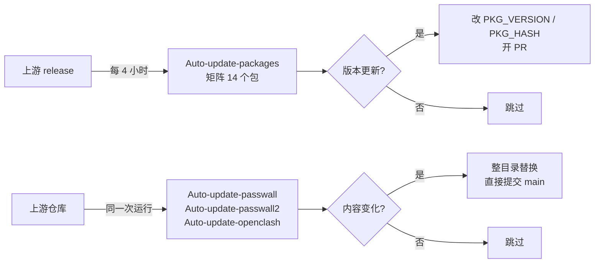

# openwrt_helloworld

[](https://github.com/MinimaxFlora/openwrt_helloworld/actions/workflows/auto-update-packages.yml)
[](#许可证)

ZeroWrt 使用的 PassWall / OpenClash 插件与其内核软件包，集中在这个仓库里自己维护。

一次构建只依赖这一个仓库，而不是四个上游仓库；上游发版异常时可以在这里单独修，
上游正常更新时由 workflow 自动跟进。

---

## 目录

- [设计取舍](#设计取舍)
- [仓库结构](#仓库结构)
- [软件包](#软件包)
- [更新机制](#更新机制)
- [手动触发](#手动触发)
- [已知上游行为](#已知上游行为)
- [在固件构建中使用](#在固件构建中使用)
- [新增一个软件包](#新增一个软件包)
- [许可证](#许可证)

## 设计取舍

**为什么合并成一个仓库。** 一个固件工程同时跟踪 `openwrt-passwall`、
`openwrt-passwall-packages`、`openwrt-passwall2`、`OpenClash` 四个上游时，任意一个发版
出问题都会让构建停在别人的代码上，而且只能等对方修。合并之后，问题在这里定位、在这里修，
构建侧不需要改动。

**为什么软件包放在仓库根目录。** 自动更新脚本按上游的目录布局直接改写 `Makefile`
（`sed` 定位 `PKG_VERSION` / `PKG_HASH`），路径保持一致就不用维护一层映射。

**为什么插件整目录替换、软件包只改版本。** 插件的全部内容都来自上游，本地不需要任何改动，
整目录同步既简单又不会漂移；软件包的版本号需要按 release 判断，所以只做最小改动并走 PR，
由人决定是否合并。

## 仓库结构

```
openwrt_helloworld/
├── xray-core/ sing-box/ hysteria/ naiveproxy/ shadow-tls/      # 内核
├── shadowsocks-rust/ shadowsocksr-libev/ v2ray-plugin/
├── xray-plugin/ dns2socks/ ipt2socks/ microsocks/ tcping/
├── chinadns-ng/ geoview/ v2ray-geodata/                        # 工具与数据
├── luci-app-passwall/ luci-app-passwall2/ luci-app-openclash/   # 插件
└── .github/workflows/auto-update-packages.yml
```

## 软件包

| 分类 | 目录 | 说明 |
| --- | --- | --- |
| 代理内核 | `xray-core`、`sing-box`、`hysteria`、`naiveproxy`、`shadowsocks-rust`、`shadowsocksr-libev` | PassWall 可选的运行内核 |
| 传输插件 | `v2ray-plugin`、`xray-plugin`、`shadow-tls` | 把代理流量伪装成常规 TLS/HTTP |
| 网络工具 | `ipt2socks`、`dns2socks`、`microsocks`、`tcping` | 透明代理与连通性探测 |
| DNS / 数据 | `chinadns-ng`、`geoview`、`v2ray-geodata` | 分流、IP 归属查询、`geoip.dat` / `geosite.dat` |
| LuCI 插件 | `luci-app-passwall`、`luci-app-passwall2`、`luci-app-openclash` | 三个 Web 界面 |

## 更新机制



全部集中在一个 workflow：`Auto update packages v3`。

| Job | 内容 | 触发 |
| --- | --- | --- |
| `job_init` | 清理旧运行记录；`ssh=true` 时启动 tmate | 每次 |
| `job_auto_update_packages` | 14 个包各一个 job，比版本、改 `Makefile`、开 PR | 每 4 小时 |
| `job_auto_update_luci` | `Auto-update-passwall` / `Auto-update-passwall2` / `Auto-update-openclash`，整目录同步并提交 | 每次 |

几个实现细节：

- 三个插件 job 可能同时结束。提交前会 `git fetch` 最新 `main` 并重放目录内容，推送被拒就重试，
  最多五次，避免并发推送互相打断。
- OpenClash 仓库自带各种内核二进制，历史超过 40 GB，所以只做
  `--filter=blob:none --sparse` 的单目录拉取。
- 版本更新一律走 PR（`patches-<包名>-<版本>` 分支），插件同步走直接提交——前者需要人判断，
  后者就是上游原文。

## 手动触发

`workflow_dispatch` 可用的开关：

| 输入 | 作用 |
| --- | --- |
| `ssh` | 启动 tmate，登录 runner 手动排查 |
| `is_update_geodata` | 本次是否处理 `geoip` / `geosite` 数据包 |
| `is_update_from_prerelease` | 版本对比时包含预发布版 |

## 已知上游行为

**xray-core 的 release 全部标记为 prerelease。** 上游脚本用
`map(select(.prerelease|not)) | first` 取版本，实际只能拿到很早的 `26.3.27`，随后判定
“本地版本更高”而跳过更新。本仓库对这一项改成取最新 tag。

**`xray-core 26.10.17` 已被上游删除。** 该 tag 在 Xray 侧已不存在，`codeload` 返回 404，
仓库里已更新到 `26.10.21`。

## 在固件构建中使用

**作为 feed：**

```sh
echo 'src-git helloworld https://github.com/MinimaxFlora/openwrt_helloworld.git' >> feeds.conf.default
./scripts/feeds update helloworld
./scripts/feeds install -a -p helloworld
```

**复制进 `package/new/`：**

```sh
git clone --depth 1 https://github.com/MinimaxFlora/openwrt_helloworld.git /tmp/hw
mkdir -p package/new
cp -r /tmp/hw/luci-app-passwall /tmp/hw/luci-app-passwall2 /tmp/hw/luci-app-openclash \
      /tmp/hw/xray-core /tmp/hw/sing-box … package/new/
```

ZeroWrt 走的是后一种：`scripts/zerowrt_core/packages.py` 把整个仓库克隆到
`package/new/helloworld/`，目录深度与 `package/feeds/<feed>/<pkg>` 一致，构建系统可直接扫描。

## 新增一个软件包

1. 把目录放到仓库根目录，确认 `Makefile` 里 `PKG_VERSION` / `PKG_HASH` 的写法与其它包一致；
2. 在 `auto-update-packages.yml` 的矩阵里补一项（`folder`、`version_head`、`hash_head`、
   `release_api_command`、`release_download_url`）；
3. 确认该包在 `PKG_ARCH` / `ifeq` 之类的特殊结构下仍能被 `sed` 正确改写。

## 许可证

各目录保留自己的许可证：

| 目录 | 许可证 |
| --- | --- |
| `luci-app-passwall`、`luci-app-passwall2` 及全部软件包 | GPL-2.0 |
| `luci-app-openclash` | GPL-3.0 |

`.github/workflows/auto-update-packages.yml` 来自
[smallprogram](https://github.com/smallprogram)，保留原始版权声明。
